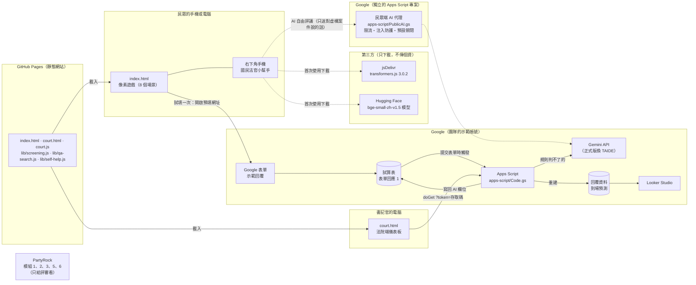
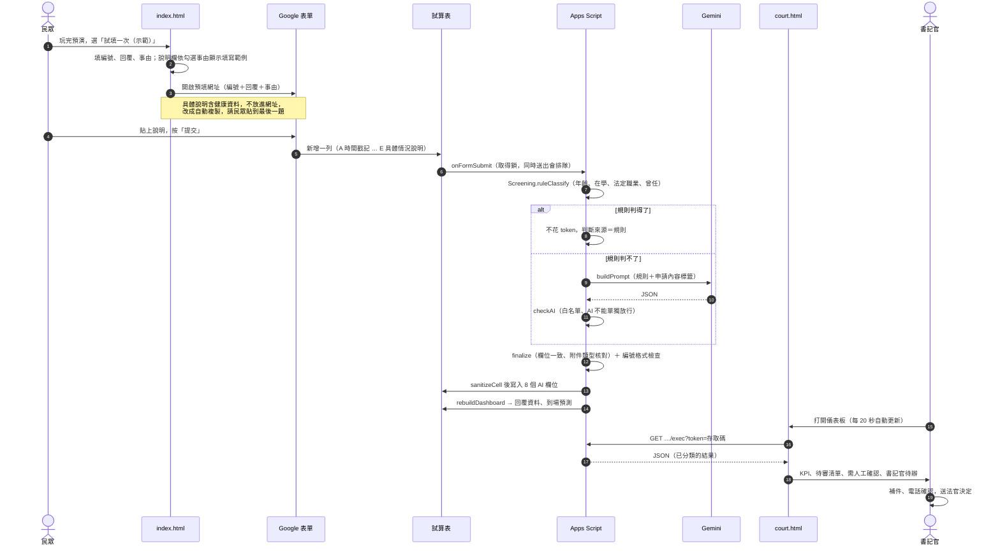
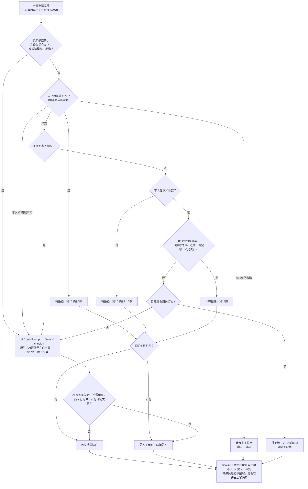
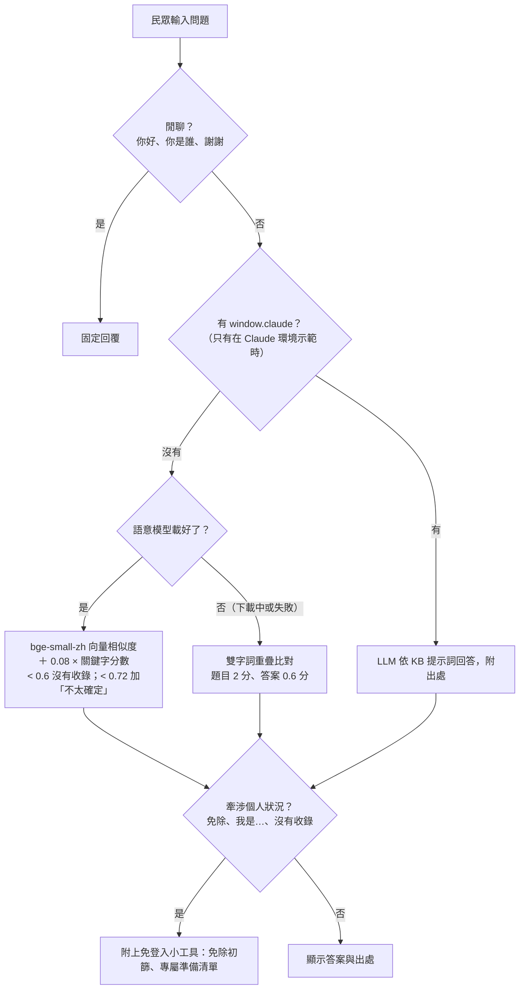
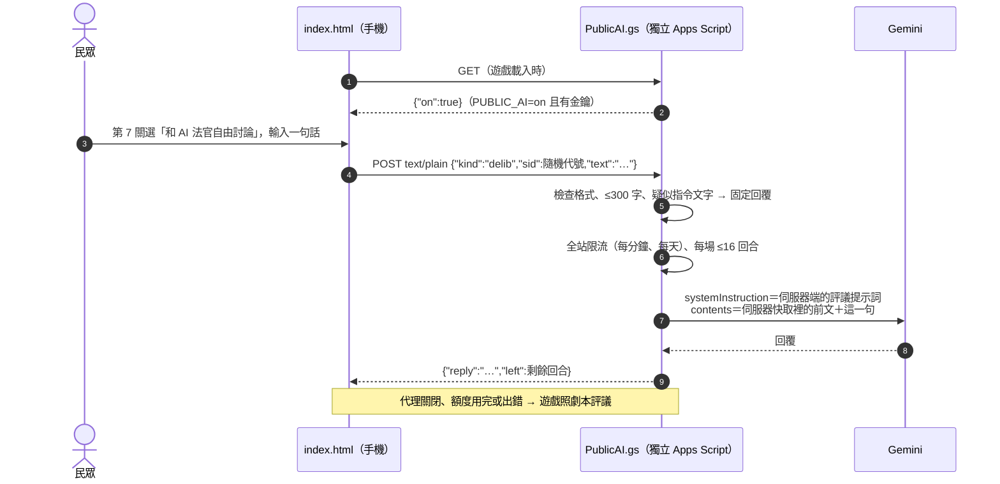
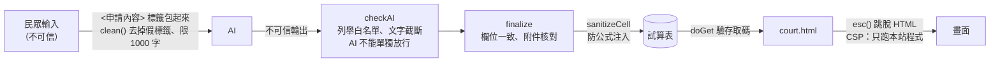
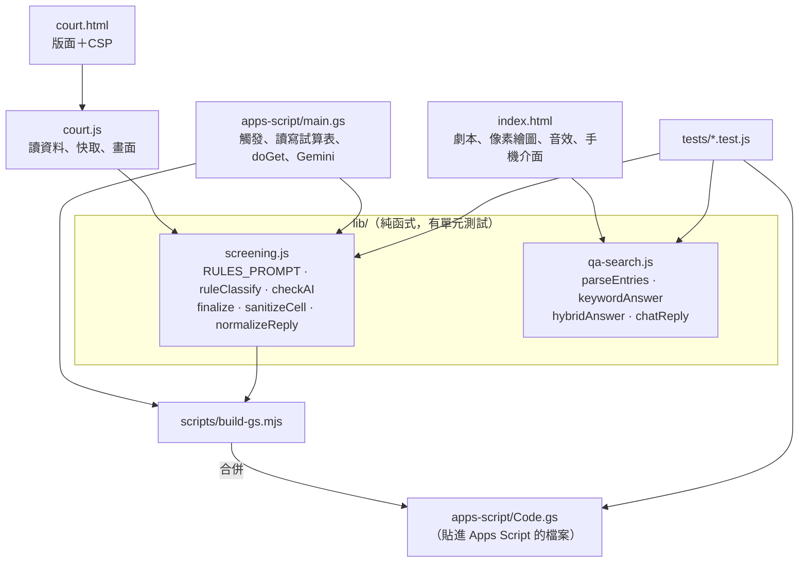

# 系統架構

這份文件說明「這次換你判：AI 國民法官預演室」由哪些部分組成、資料怎麼流動、每個部分在哪裡執行。
圖用 Mermaid 繪製，在 GitHub 上會直接顯示成圖。

> 定位：**官方調查表不改，我們幫民眾看懂它、幫書記官審完它。**
> 民眾端讓人在回覆前先看懂流程與調查表（第 13、14、16 條逐款白話說明）；法院端用「規則＋AI」初篩免除申請的自由文字，最後由法官決定。

---

## 1. 全貌：誰用、在哪裡跑



| 元件 | 檔案 | 在哪裡執行 | 處理個資？ |
|---|---|---|---|
| 民眾端遊戲 | `index.html` | 民眾的瀏覽器 | 否。遊戲選擇不會送出 |
| 問答小幫手 | `index.html` + `lib/qa-search.js` | 民眾的瀏覽器（語意模型也在瀏覽器裡跑） | 否。問題不離開瀏覽器 |
| 免除初篩、專屬準備清單（模組 3、2） | `index.html` + `lib/self-help.js` + `lib/screening.js` | 民眾的瀏覽器 | 民眾自己輸入，**不離開瀏覽器** |
| AI 自由評議（模組 5） | `apps-script/PublicAI.gs` | 獨立的 Google Apps Script → Gemini | 否。只談虛構案件；預設關閉 |
| 示範表單 | Google 表單 | Google | 是（只能用虛構資料） |
| 自動分類 | `apps-script/Code.gs`（= `apps-script/main.gs` + `lib/screening.js`） | Google Apps Script | 是 |
| AI 模型 | Gemini API（原型）／TAIDE（正式版） | Google／法院自建 | 是（只送規則判不了的那幾筆） |
| 法院端儀表板 | `court.html` + `court.js` + `lib/screening.js` | 書記官的瀏覽器 | 是 |
| 統計圖表 | Looker Studio | Google | 統計數字為主 |
| AI 工具箱（評審展示用） | PartyRock（模組 1、2、3、5、6） | AWS PartyRock | 不放在民眾端（要登入） |

---

## 2. 一筆回覆的完整旅程



---

## 3. 免除申請怎麼判（兩層初篩）



規則層的判斷都有測試案例（`tests/fixtures/exemptions.json`），`npm run eval` 會算出覆蓋率與正確率。

---

## 4. 問答小幫手怎麼回答



資料庫：41 題司法院國民法官常見問答（Q3601–Q3641）＋ 20 題補充（A001–A020），內嵌在 `index.html` 的 `KB`；口語問法在 `ALT`、`MORE_ALT`。

---

## 4-1. 民眾不用登入：每個 AI 功能在哪裡跑

以前民眾端的模組 2、3、5 都要另開 PartyRock，而 PartyRock 要先登入 AWS 帳號，收到通知的民眾不會為了這個去註冊。現在依「會不會碰到個資」分兩種做法：

| 功能 | 做法 | 為什麼 |
|---|---|---|
| 問答小幫手（模組 1） | 瀏覽器內語意搜尋（已經是這樣） | 只回資料庫原文，不會幻覺 |
| 免除初篩＋說明草稿（模組 3） | 瀏覽器內：`Screening.ruleClassify`（和法院端同一套規則）＋ `SelfHelp.checkSituation` 關鍵字分類（第 16 條第 4、6、7、8、10 款） | 民眾會寫病名、家人狀況（個資法第 6 條的敏感資料），不送到任何伺服器；草稿只把民眾自己寫的內容套進固定格式 |
| 專屬準備清單（模組 2） | 瀏覽器內：選身分、勾擔心的事 → `SelfHelp.buildGuide` 挑出常見問答原文 | 只引用原文，不產生新文字 |
| AI 自由評議（模組 5） | `apps-script/PublicAI.gs` 代理 Gemini；`index.html` 的 `AI_PROXY` 空白時不顯示 | 真的需要生成式 AI；只談虛構案件，不碰個資 |



設計重點：金鑰只在指令碼屬性；提示詞和對話紀錄都在伺服器端，民眾只能送「自己說的一句話」，所以不能把它變成任人使用的免費 AI，也不能偽造 AI 說過的話。代理放在**獨立**的 Apps Script 專案，碰不到法院端試算表。

---

## 5. 信任邊界與防護



| 威脅 | 防護 | 位置 |
|---|---|---|
| 提示注入（「忽略以上規則…」） | 標籤包裝、`INJECT` 偵測、白名單、AI 不能單獨放行 | `lib/screening.js` |
| 公式注入（`=IMPORTDATA(…)`） | `sanitizeCell()` | `lib/screening.js`、`apps-script/main.gs` |
| XSS | `esc()`、CSP `script-src 'self'` | `court.js`、`court.html` |
| 試算表外流 | 網頁應用程式＋存取碼，試算表不公開 | `doGet()` |
| 金鑰外流 | 金鑰放 Apps Script 指令碼屬性；瀏覽器預設只存 sessionStorage | `main.gs`、`court.js` |
| 同時寫入 | `LockService` | `withLock_()` |
| 健康資料留在網址 | 說明不進預填網址，改複製貼上 | `index.html` |

---

## 6. 程式碼結構



```
juror-preview/
├── index.html              民眾端：像素遊戲＋問答小幫手
├── court.html              法院端：儀表板版面與 CSP
├── court.js                法院端：程式
├── lib/
│   ├── screening.js        免除初篩（court.html 與 Apps Script 共用）
│   ├── qa-search.js        問答比對
│   └── self-help.js        民眾端免除初篩、專屬準備清單（取代 PartyRock 模組 2、3）
├── apps-script/
│   ├── main.gs             法院端 Apps Script 原始碼（模組 6）
│   ├── Code.gs             自動產生，貼進法院端 Apps Script 的就是這個
│   ├── public-ai.gs        民眾端 AI 代理原始碼（模組 5 自由評議）
│   └── PublicAI.gs         自動產生，貼進「另一個獨立」Apps Script 專案
├── prompts/                PartyRock 提示詞（模組 2、3、5、6）
├── scripts/build-gs.mjs    產生 Code.gs、PublicAI.gs
├── tests/                  單元測試、標註資料、準確度評估
└── docs/                   說明文件（本資料夾）
```

---

## 7. 部署與更新

| 改了什麼 | 要做什麼 |
|---|---|
| `index.html`、`court.html`、`court.js`、`lib/*` | 合併到 `main` 後 GitHub Pages 自動更新（約 1 分鐘） |
| `lib/screening.js` 或 `apps-script/main.gs` | `npm run build:gs` → 把 `apps-script/Code.gs` 全部貼進 Apps Script → 儲存。若有用網頁應用程式：「部署 → 管理部署作業 → 編輯 → 新版本」 |
| `RULES_PROMPT`（事由清單或規則） | 同上，另外手動同步 `prompts/` 和 PartyRock 模組 3、6 |
| 評議提示詞（`index.html` 的 `DELIB`） | `npm run build:gs` → 把 `apps-script/PublicAI.gs` 貼進民眾端 AI 代理 → 部署新版本；同步 PartyRock 模組 5 |
| 問答資料庫（`KB`） | 改 `index.html`，同步 `prompts/PartyRock問答提示詞.txt` 與 PartyRock，跑 `npm test` |

詳細設定步驟見 [SETUP.md](SETUP.md)；欄位格式見 [DATA_SCHEMA.md](DATA_SCHEMA.md)。
