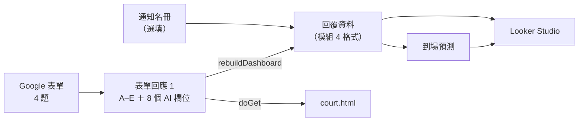

# 資料格式

資料從 Google 表單一路流到 Looker Studio，中間每一站的欄位如下。改任何一站的欄位或選項文字，都要對照這份文件。



## 1. Google 表單（示範用）

| 題號 | 題目（建議標題） | 類型 | 選項（文字要完全一致） | 預填代號 |
|---|---|---|---|---|
| 1 | 候選人編號 | 簡答 | 例：C999 | `entry.1612295714` |
| 2 | 你的回覆 | 單選 | `到場`／`申請免除`／`尚未決定` | `entry.1258938889` |
| 3 | 勾選的事由 | 核取方塊 | 見下方 8 個選項 | `entry.1051708947` |
| 4 | 具體情況說明 | 段落 | 自由文字（不預填，民眾自己貼上） | `entry.964700410` |

第 3 題選項（和 `index.html` 的 `REASONS` 相同）：

1. 年滿 70 歲以上
2. 具有老師或學生身分
3. 要照顧家人或養育小孩，執行職務有困難
4. 有重大疾病、傷害或身心因素
5. 重大受災戶，需要處理生活重建
6. 5 年內擔任過國民法官
7. 職業或身分不能擔任（如法官、檢察官、律師、警察、軍人）
8. 其他（請在說明欄寫明）

> 預填代號在 `index.html` 的 `FORM`。換一份表單，要從「取得預先填入的連結」重新拿代號。

## 2. 表單回應 1（試算表）

| 欄 | 內容 | 誰寫的 |
|---|---|---|
| A | 時間戳記 | Google 表單 |
| B–E | 表單第 1–4 題 | Google 表單 |
| 之後 | `AI 對應事由`｜`AI 類型`｜`AI 建議`｜`需人工確認`｜`AI 理由`｜`書記官待辦`｜`AI 處理時間`｜`判斷來源`｜`規則版本` | Apps Script（不存在會自動新增在最右邊） |

- Apps Script 用**標題文字**找 B–E（`FIELDS`），題目順序改了也找得到；找不到才用預設位置。
- `判斷來源`：`規則`／`AI`／`待人工`（AI 失敗）。編號格式異常或不在通知名冊、規則又判不了的，不送 AI，也標 `規則`，待辦寫要核對什麼。
- `規則版本`：寫入時的 `RULES_VERSION`。選單「分類所有尚未處理的申請」會重跑兩種列：`AI 處理時間` 空白的，以及 `判斷來源` 是 `規則` 但版本不是目前版本的。
- 同一位候選人後來又送出時，舊的那筆 `AI 建議` 寫「（同一人後來又送出，以最後一次為準）」，不分類也不送 AI。
- `書記官待辦` 不會出現「可直接送法官」：最好的情況是「核對○○後送法官」（附件只是民眾自述）。
- 所有 AI 欄位寫入前都經過 `sanitizeCell()`，開頭是 `= + - @` 的會加上 `'`。

AI 欄位的允許值：

| 欄位 | 允許值 |
|---|---|
| AI 類型 | `不得擔任`／`得拒絕`／`無` |
| AI 建議 | `可能符合`／`資料不足`／`看起來不符合`（非免除申請寫 `（非免除申請，不需分類）`） |
| 需人工確認 | `是`／`否` |

## 3. 通知名冊（選填，自己建立）

工作表名稱必須是 `通知名冊`，第一列是標題：

| 候選人編號 | 案號 | 通知寄出日 |
|---|---|---|
| C001 | 115年度國模重訴字第1號（模擬） | 2026/11/02 |

有名冊時，「回覆資料」以名冊為準，沒回覆的人會標 `未回覆`，到場預測才算得出「未回覆者」。可以直接把模組 4 xlsx「回覆資料」的 A–C 欄貼過來。

## 4. 回覆資料（Apps Script 產生，模組 4 格式）

欄位和《模組4_法院儀表板模擬資料.xlsx》的「回覆資料」完全相同，Looker Studio 換資料來源不用改圖表。

| 欄位 | 來源 |
|---|---|
| 候選人編號 | 名冊；沒有名冊就用表單回覆 |
| 案號、通知寄出日 | 名冊 |
| 回覆狀態 | 表單「你的回覆」經 `normalizeReply()` 轉換（見下表）；名冊上沒回覆的為 `未回覆` |
| 回覆日期 | 表單時間戳記 |
| 是否使用AI導覽 | 留空（表單沒有收集，見「待補」） |
| 免除事由（AI初篩） | `AI 對應事由`（只有申請免除的人） |
| 提問內容、提問分類 | 留空（問答在民眾瀏覽器裡，不回傳，保護隱私） |

同一位候選人回覆多次，以**最後一次**為準。

### 回覆狀態對照

| 表單選項 | 模組 4／Looker | 到場預測怎麼算 |
|---|---|---|
| `到場` | `會到場` | × 履約率 0.9（假設） |
| `申請免除` | `申請免除` | 不計入 |
| `尚未決定` | `尚未決定` | × 歷史到場率 0.489（113 年） |
| （沒回覆） | `未回覆` | × 歷史到場率 0.489 |

> 舊版模組 4 只有 `會到場／申請免除／未回覆` 三種，沒有 `尚未決定`。

## 5. 到場預測（Apps Script 產生）

| 列 | 項目 | 公式 |
|---|---|---|
| 2 | 通知人數 | `COUNTA(回覆資料!A:A)` |
| 3 | 回覆會到場 | `COUNTIF(…,"會到場")` |
| 4 | 申請免除 | `COUNTIF(…,"申請免除")` |
| 5 | 未回覆 | `COUNTIF(…,"未回覆")` |
| 6 | 尚未決定 | `COUNTIF(…,"尚未決定")` |
| 7 | 回覆率 | `(B3+B4+B6)/B2` |
| 8 | 履約率（假設） | 0.9 |
| 9 | 歷史到場率 | 0.489（113 年 3,618／7,399） |
| 10 | 預測到場人數 | `ROUND(B3×B8 + (B5+B6)×B9)` |
| 11 | 選任所需人數（假設） | 指令碼屬性 `NEEDED_PER_CASE`；沒設暫用 57（113 年平均每案到場人數，**不是需求人數**） |
| 12 | 預測是否足額 | `IF(B10>=B11,"足額","不足，建議追加通知")` |

## 6. court.html 讀到的 JSON（`doGet`）

```json
{
  "ok": true,
  "rulesVersion": "2026-11-04.2",
  "generatedAt": "2026-11-04T10:00:00.000Z",
  "rows": [
    {
      "ts": "2026/11/04 10:00:00", "id": "C023", "reply": "申請免除",
      "reasons": "有重大疾病、傷害或身心因素", "note": "上個月剛做完心臟手術……",
      "ai": { "AI 對應事由": "…", "AI 類型": "得拒絕", "AI 建議": "可能符合", "需人工確認": "是",
              "AI 理由": "…", "書記官待辦": "請補診斷證明", "AI 處理時間": "2026-11-04 10:01", "判斷來源": "AI",
              "規則版本": "2026-11-04.2" }
    }
  ]
}
```

存取碼錯誤時：`{"ok": false, "error": "存取碼錯誤或尚未設定 DASHBOARD_TOKEN"}`。

`rulesVersion` 和 court.html 載入的 `lib/screening.js` 不同時，court.html 上方會顯示「規則版本不一致」。

## 待補

- **是否使用AI導覽**：可以在表單加一題隱藏的簡答，遊戲預填 `是`，就能比較「有玩預演」和「沒玩」的人的到場率（社會影響的主要證據）。需要新的預填代號。
- **提問分類**：問答目前完全在瀏覽器裡，不回傳。若要統計，建議只回傳題號（例如 `Q3637`），不回傳原文。
